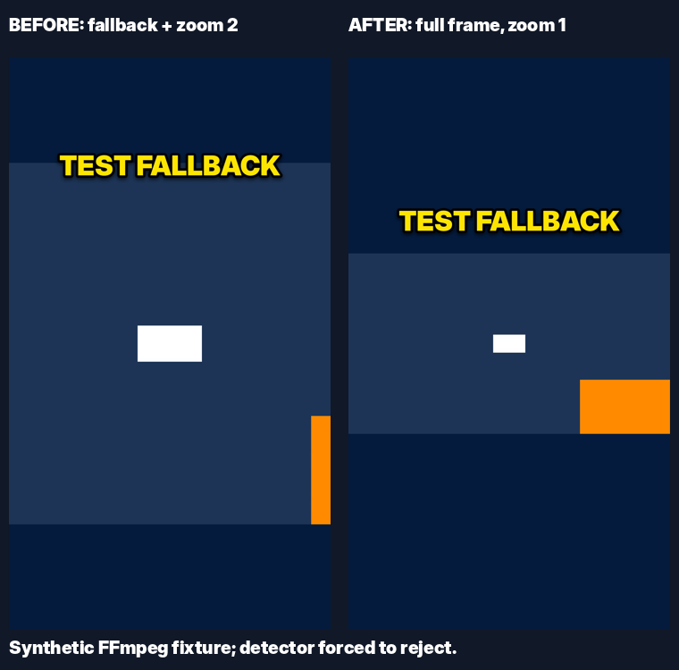

# CS2 Clip Factory engineering audit — 2026-10-30

## Verdict

**FIX BEFORE MERGE / keep automatic mode experimental and disabled by default.**
PR #7 at `a3de08dff3b8bc1cbe3af8be266c70805eae5204` is not evidence of reliable
webcam localization. It finds frontal faces, expands them with a fixed heuristic,
and sometimes substitutes historical dimensions. None of those operations measures
webcam borders. The audit fixes concrete failures but does not certify real Twitch
accuracy. Manual review remains necessary even when every heuristic passes.

No confirmed Critical finding. High and Medium findings below are separated from
unmeasured algorithmic risks. No production credentials, private media, or Mac files
were accessed; no clips were published and no PR was merged.

## Scope and evidence

Read all application modules, every changed file in PR #7, configuration/examples,
all tests, PR commit history and CI. Base main: `23f78936e413a0552788a5cd67466aa3fb27a66d`.
Initial GitHub Actions run: [41008587943](https://github.com/alennchik/cs2-clip-factory/actions/runs/41008587943), success.
It installs `.[dev]`, not OpenCV. Original local suite: **102 passed in 48.98 s**;
Ruff check and format check passed. Green baseline tests did not detect the failures below.

The two branches are independent:

- [PR #8](https://github.com/alennchik/cs2-clip-factory/pull/8),
  `audit/webcam-safety-20261030`: based on PR #7; targets its feature branch.
- [PR #9](https://github.com/alennchik/cs2-clip-factory/pull/9),
  `audit/pipeline-recovery-20261030`: based on main; operational fixes outside PR #7.

## Findings and reproductions

References below describe the **original** code at PR #7's audited SHA; functions
remain the preferred navigation anchor after patches.

| Severity | Original location | Evidence / consequence | Resolution |
|---|---|---|---|
| High | `calibrate.py:25-79`, `webcam_auto.py:103-110` | Largest face only; 3.6x expansion and assumed 16:9 panel; old dimensions reused. A stable peripheral game face or resized webcam can pass. | Multiple faces now reject; size gates and raw-face containment added. Border identification and semantic false positives remain unresolved. |
| High | `webcam_auto.py:80-110` | `[panel,panel,panel,None,None]` returns a crop, despite disappearance. | 4/5 coverage and both endpoints required; first and near-last frames now sampled. Short changes between samples remain invisible. |
| High | `webcam_auto.py:97-106`, `layout.py:webcam_box` | Independent medians can violate x+w<=1. For x=[.70,.75,.80,.80], w=1-x, h=.2 the original median gives x=.80,w=.25. Also IoU>=.4 does not imply the old crop contains the face. Aspect-fill trims the panel again. | Observed medoid instead of independent medians; all observed raw faces must fit the actual even-pixel, aspect-trimmed FFmpeg crop. |
| Medium | `webcam_auto.py:56-73` | Hint w=.2404 relocated right gives rounded x=.760, x+w=1.0004: ValidationError. | Preserve coordinate precision; do not snap merely nearby estimates to edges. |
| High | `webcam_auto.py:142`, `calibrate.py:70-75` | `TimeoutExpired`, empty cascade / cv2.error escape optional detection and can abort processing. | Fail closed with diagnostic reason; missing dependency checked before extraction; load cascade once per clip. |
| Medium | `render.py:287-310`, `layout.py:fit_size` | Fallback still uses fit_zoom=2, removing side content. Portrait taller than 9:16 is cropped even with zoom=1. | Automatic fallback forces zoom=1; full layout contains both source dimensions. Pixel regression covers hook+sponsor compatibility. |
| Medium | `render.py:304`, `pipeline.py:render_clip`, `review.py:caption` | Decision only in INFO logs; Telegram reviewer cannot tell why layout changed. | Structured `webcam_detection` event with box/reason/counts; warning placed before caption truncation. |
| Medium | `cli.py:render_file` | Config enables detection, but render-file without --webcam/--auto-webcam requests full, so detection is bypassed; no explicit disable flag for manual comparison. | Config and paired --auto-webcam/--no-auto-webcam override now consistent. |
| High | `pipeline.py:51-65` | Only DISCOVERED selected. A crash after FETCHED/TRANSCRIBED strands a clip. Fifty higher-scored disallowed clips starve an eligible clip forever. | Separate recovery branch selects resumable states and filters allowlist before LIMIT; intact cached media/transcripts reused. |
| Medium | `pipeline.py:37-65` | Fixed 30 s start-distance wrongly skips [100,110] vs [125,135], but accepts overlapping [100,160] vs [140,200]. Alternatives are marked skipped before the selected winner succeeds. | Actual half-open source intervals; unresolved alternatives deferred. Only successfully rendered spans suppress new clips. |
| High | `telegram.py:43-60`, `review.py:run` | An HTTP transport exception can include /botTOKEN/... and be logged with its exception chain. Reproduced using a dummy token and MockTransport, not a live token. | Separate recovery branch sanitizes transport errors, suppresses secret-bearing chain, redacts echoed token in API errors. |
| Medium | `review.py:_on_message`, `_on_callback` | Pending custom-hook reply can re-render a version approved in the meantime. Callback checks user but not destination chat. | Recheck render state; require both owner user and private owner chat. |
| Medium | `pipeline.py:load_transcript`, `process_clip` | Corrupt transcript cache is reloaded during render; probe timeout can escape the per-clip failure boundary. | Recovery branch treats invalid cache as missing and isolates timeouts/validation failures per clip. |

Regression suites: `tests/test_webcam_safety.py`, `tests/test_webcam_integration.py`,
`tests/test_recovery.py`, plus additions to existing webcam/review/Telegram/layout tests.
Five new safety cases failed before patching (plus an independently reproduced median
crash); six queue/recovery cases and three review/transport cases failed on main.

A further recovery fix refreshes delayed VOD IDs/offsets in `db.upsert_clip` without
resetting status. Previously an initial null offset stayed null across rediscovery.
Final review also reproduced stale ASR reuse after restoring a source with different
bytes. `db.save_media` now invalidates the transcript reference when the source hash
changes (before saving new media); identical restored media retains its transcript.

## Production call chain

`cli._run_once` holds the pipeline flock -> `discover` reads Helix metadata ->
`select_candidates` selects allowed clips -> `fetch_clip` downloads via yt-dlp,
probes and hashes -> `transcribe_clip` -> speech/title hooks -> `render_clip` ->
`render_video` chooses the time window -> webcam detection -> text geometry and
`RenderJob` -> `build_filtergraph` -> FFmpeg -> optional sponsor insertion ->
`db.create_render` -> Telegram draft -> human approval -> local export.

Detection already ran before text/crop finalization in the original PR. Its coordinates
reach `RenderJob.webcam`, `layout.webcam_box`, and FFmpeg's `crop=w:h:x:y`.
This is now checked using actual decoded output pixels, rather than only asserting
`result.layout == 'split'`. Explicit full, disabled auto, missing hint, CLI override,
selected time window, and stored review diagnostics are covered separately.

Sponsor insertion runs **after** layout rendering, splits the completed video at a
quiet audio window, inserts a segment, and verifies total duration. The heuristic is
not a kill/clutch detector. Original hook/caption timestamps shift together with the
video because insertion happens after compositing. Sponsor audio itself is not
normalized to the gameplay loudness target.

## Algorithm assessment

| Approach | What it can establish | Runtime / complexity | Assessment |
|---|---|---|---|
| Existing Haar + face expansion | Location of some frontal faces; guessed surrounding crop | Small local dependency; cheap compared with ASR/rendering; missed profiles/small faces | Retain only as experimental baseline. Consensus is not calibrated confidence. |
| YuNet through OpenCV FaceDetectorYN | Better candidate face boxes/landmarks; still not webcam boundaries | Small local model and versioned asset required; no paid API | Best next detector to benchmark, not an accuracy guarantee. Official examples show advantages over Haar, not Twitch performance. |
| Rectangle/edge detection | Candidate panel boundaries when contrast/border exists | Lightweight, but HUD, radar, banners and gameplay rectangles create candidates | Corroborate a face candidate; never accept a rectangle alone. Borderless/transparent overlays are hard. |
| Historical webcam template + face | Previously approved panel appearance and expected dimensions | Per-streamer templates; multiscale matching when layout changes | Useful strong prior; stale templates/size changes must reject rather than silently crop. |
| Temporal tracking | Continuity between detected positions | More sampled frames/decoding; drift and scene-cut handling required | Track a corroborated panel, not the moving head. Tracking alone cannot establish initial correctness. |

Recommended next architecture: benchmark a lightweight face detector on labelled clips,
combine it with panel/template evidence, reject ambiguous candidates, and track/segment
only after panel validity is established. Keep whole-frame fallback for uncertainty.
Do not substitute an unvalidated rectangle heuristic or a large VLM for the present
unvalidated expansion. No heavy model/infrastructure was added by this audit.

Primary references (consulted 2026-10-30):
- [OpenCV FaceDetectorYN API](https://docs.opencv.org/4.12.0/df/d20/classcv_1_1FaceDetectorYN.html)
- [OpenCV comparison of Haar and YuNet](https://opencv.org/blog/opencv-face-detection-cascade-classifier-vs-yunet/)

## Validation and measured performance

Webcam branch: **138 passed in 69.18 s**, including FFmpeg integration, and Ruff passed
in Linux x86_64 / Python 3.12.14 / OpenCV 4.14.0 / Ruff 0.16.10. CI now has dev-only
and dev+vision jobs; missing OpenCV is also tested explicitly. Both jobs passed on GitHub.
The recovery branch initially passed 110 tests locally and in GitHub CI; after the
changed-source ASR regression, it passed **112 locally in 55.75 s**. A temporary local
combination of both branches and that final fix passed **157 tests in 63.65 s** plus
Ruff/format checks. No GitHub PR was merged. CI links, commits and detailed results
are recorded in `AUDIT_PROGRESS.md`.

Timing experiment: five extractions + real Haar on a **3 s synthetic 1920x1080 clip
with no faces**, three sequential runs in each implementation. Original seconds:
1.294, 1.181, 1.416 (median 1.294). Revised: .930, 1.022, 1.068 (median 1.022).
Python peak RSS observed 132280 vs 121048 KiB; this excludes child FFmpeg peak memory.
These are a small shared-Linux experiment, **not an M2 benchmark**, nor a face-accuracy
measurement. Do not interpret the difference as a guaranteed speedup.

Extraction now scales before PNG encoding, bounds both dimensions to 1280, loads the
cascade once, and does zero extraction when OpenCV is absent. Up to five independent
seek/decode processes remain. Each extraction has a 15 s timeout, so pathological
inputs can still spend up to about 75 s in extraction; decoder/model time is additional.
A single sequential decoder is worth benchmarking for long/GOP-heavy clips, not
assuming faster: it may decode much more intervening video.

Expected M2 overhead is likely seconds per clip rather than model-sized RAM, but this
is an unmeasured estimate. MLX Whisper remains resident while FFmpeg runs; captions
can create up to 60 full-size PNG inputs. Measure unified memory and swap on the actual
8 GB Mac. VideoToolbox, MLX, launchd and sustained fanless thermal behavior were not tested.



The comparison forces detection failure on the same synthetic source. Left: original
zoomed fallback loses most of the orange webcam. Right: patched fallback preserves
the whole source. It proves fallback geometry, **not webcam detection accuracy**.

## Real-world readiness and required private fixtures

No layout is certified for automatic real-world accuracy by this audit. Geometry and
integration tests support four-corner estimates, stable camera/head motion, missing
camera, relocation between clips, movement during sampled frames, multi-face rejection,
wrong historical sizes, portrait/ultrawide frames, missing dependency and extraction
failures. These are controlled detections or synthetic videos. Real OpenCV smoke tests
use a black image, not real streamer faces.

Manual review is mandatory for small/profile/occluded faces, changed camera dimensions,
borderless webcams, HUD/radar/ad overlap, PiP/guests, fullscreen scenes, camera changes
between sample times, rotated video or non-square pixels. A stable false face can still
pass. The fixed thresholds .35 IoU / 1.8 size ratio / 4-of-5 coverage are conservative
engineering gates, **not thresholds fitted to a labelled validation set**.

For actual evaluation, provide these local files (names are suggested except the first
path, which is referenced in PR #7):

1. `data/raw/keliencs_private_test.mp4`, with its approved box `0,0,0.24,0.235` confirmed.
2. `strogo_old_layout.mp4` and `strogo_moved_layout.mp4` from different broadcasts.
3. `webcam_moves_midclip.mp4`, `webcam_disappears.mp4`, `no_webcam_gameplay.mp4` (e.g. deko).
4. `webcam_resized.mp4`, `multiple_faces_or_pip.mp4`, `fullscreen_camera.mp4`.
5. 720p and 1080p small-face/profile examples; a frame near each transition with the
   correct panel rectangle and time interval labelled.
6. Only the relevant redacted `render:` and streamer `layout/webcam/game_center_x` config.
   Do not send `.env`, tokens, permissions screenshots or unrelated personal files.
7. The actual `assets/sponsor/banner.mp4` is needed only for checking that specific asset.

A handful of five-frame PNG sets can diagnose static placement, but original 10–30 s
video segments are needed for moves/disappearance. None of the listed files was
available in this Work environment; Twitch credentials/live download were not exercised.

## Other system risks remaining

- `run_control.pipeline_lock` protects scheduled/on-demand `run`. Standalone fetch,
  transcribe/render, bot hook re-render, and review-send are not all under this lock.
  Concurrent work can duplicate sends/renders and exceed an 8 GB memory budget.
- SQLite uses WAL, busy timeout, parameter binding and foreign keys, but status/media/
  event updates are separate autocommit statements. There is no transactional work claim
  or durable delivery outbox; crash recovery is improved, not exactly-once processing.
- Telegram persists update offsets before handling; delivery failures after approval
  can require manual recovery. An atomic state transition plus retryable outbox is the
  appropriate follow-up, not blind retries of non-idempotent sends.
- Failed jobs remain failed until an explicit retry. No retry budgets/backoff for all
  transport exceptions. Helix retries status responses but not all network errors.
- VOD metadata missing means no interval dedup; byte hashes miss equivalent re-encodes.
  Rank scores for old, no-longer-refreshed rows can become stale. Candidate scanning has
  a bounded overfetch window, so a large prefix of duplicates may need another run.
- MLX/faster-whisper quality, speaker attribution, non-speech hallucinations, and
  low-confidence hook text require listening to real clips. Hook changes keep the old
  selected window, which may omit an alternative hook's speech.
- Source/sponsor parsing lacks a unified probe/timeout/error policy; malformed SAR,
  rotation metadata, unusual fps, long user-provided videos remain outside tested scope.
- Dependency versions are mostly open ranges, no lockfile; CI covers Linux, not Apple
  Silicon. Packaging the bundled font for non-editable installs needs a separate check.
- `permission: explicit` is a local operator allowlist setting (and default), not
  independent evidence of redistribution or monetization rights. Proof/note fields are
  records, not validated grants. The recovery branch makes this explicit in docs/doctor
  while preserving existing configuration behavior. The audit makes no legal finding.

## Safe local verification

Do not overwrite an active scheduler checkout. Fetch the audit branch into a separate
worktree and run **local files only**, without Telegram/Twitch credentials:

```bash
cd ~/Desktop/cs2-clip-factory
git fetch origin
git worktree add ../cs2-webcam-audit origin/audit/webcam-safety-20261030
cd ../cs2-webcam-audit
python3.12 -m venv .venv
source .venv/bin/activate
python -m pip install -e '.[dev,vision]'
python -m ruff check .
python -m ruff format --check .
python -m pytest
mkdir -p out/test
clipfactory render-file ../cs2-clip-factory/data/raw/keliencs_private_test.mp4 \
  --webcam 0,0,0.24,0.235 --no-auto-webcam --end 6 --out out/test/manual.mp4
/usr/bin/time -l clipfactory render-file ../cs2-clip-factory/data/raw/keliencs_private_test.mp4 \
  --webcam 0,0,0.24,0.235 --auto-webcam --end 6 --out out/test/auto.mp4
open out/test/manual.mp4 out/test/auto.mp4
```

Repeat without `--end 6` on full clips, and repeat for every fixture above. Check beginning,
middle, end, transitions, complete faces, radar/gameplay crop, hook visibility, sponsor
cut/audio and no-camera fallback. A correct 6 s preview alone does not validate a 45 s clip.

Only after real-media acceptance and owner approval to merge should `render.auto_webcam:
true` be added to the production YAML. Keep `layout: full` for known no-camera broadcasts.
To disable, set `auto_webcam: false`; `--no-auto-webcam` overrides it for one local render.
Do not alter or reinstall launchd jobs merely to try the audit branch.
